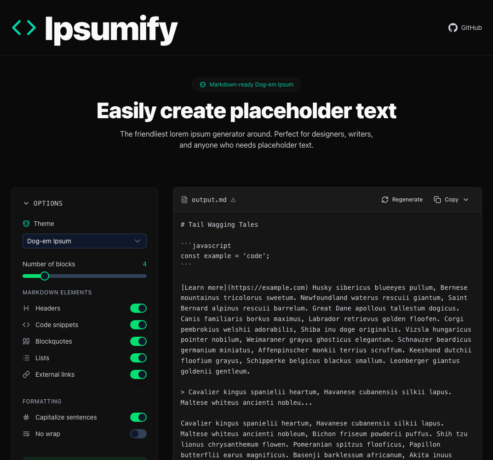
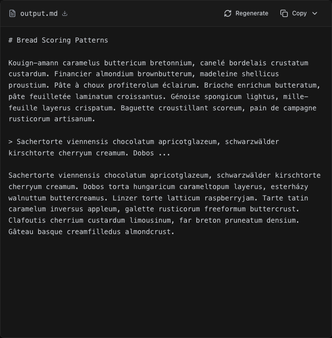
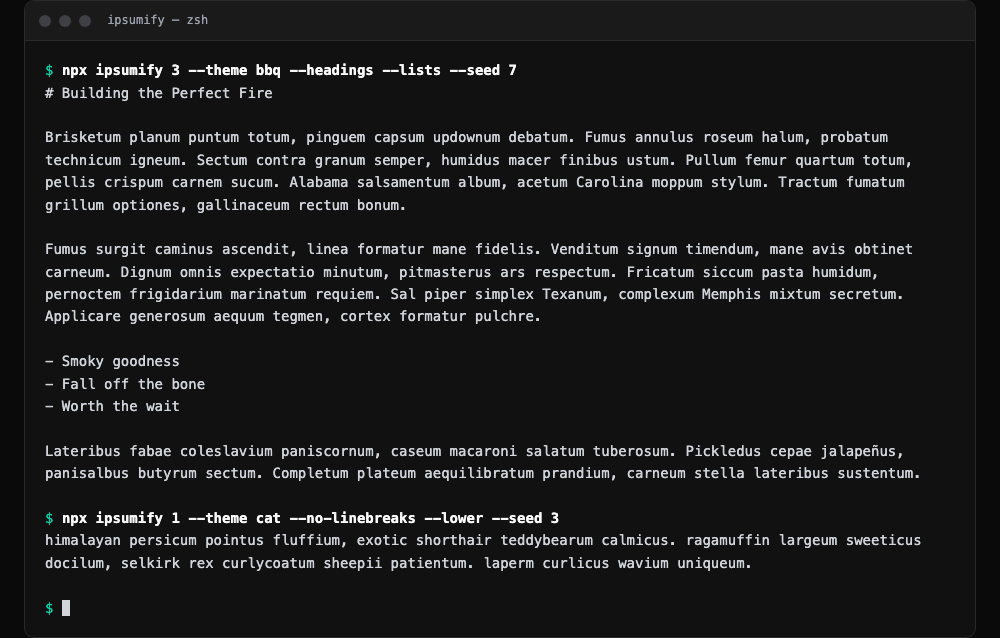
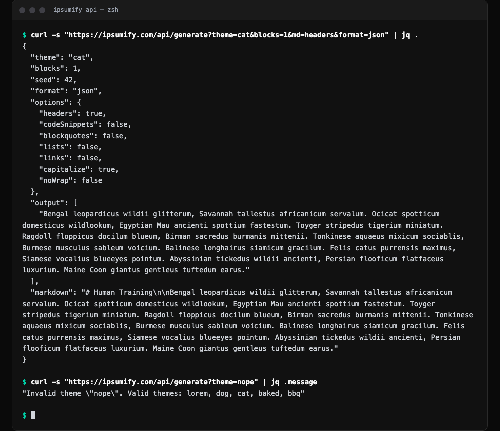
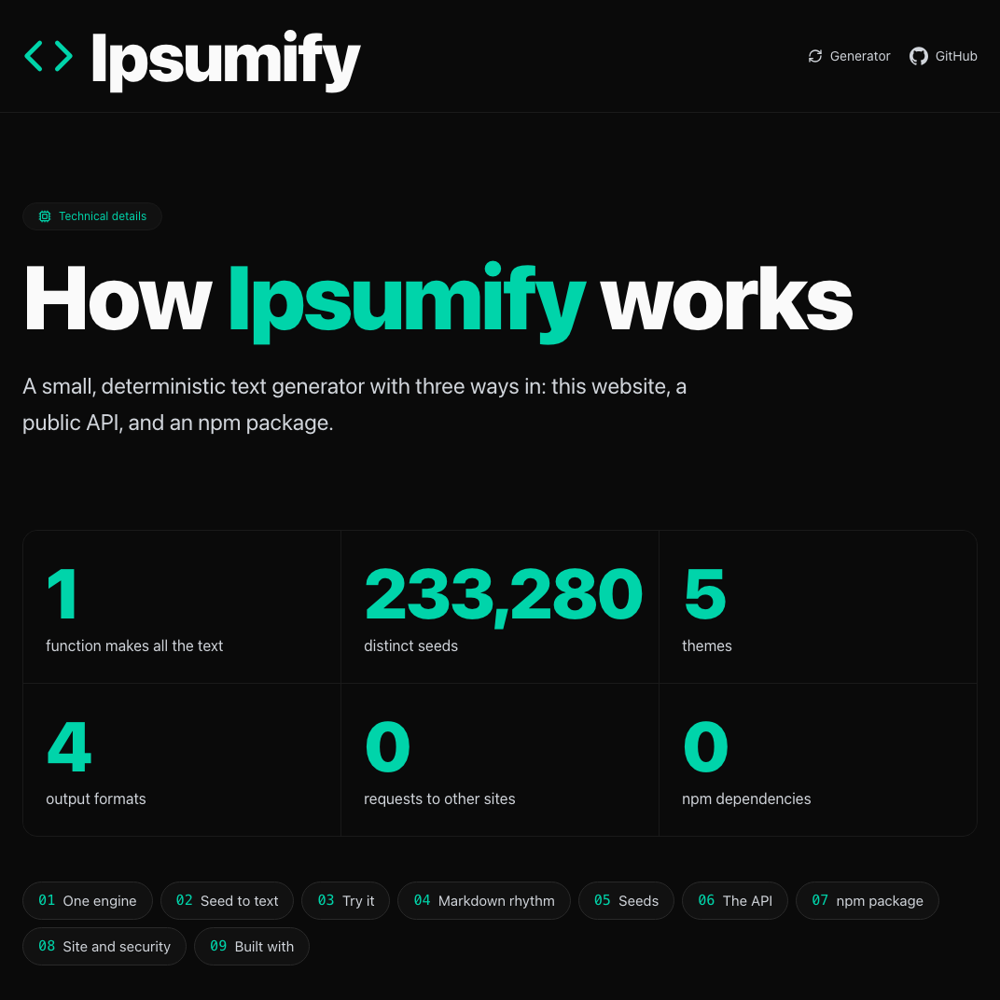
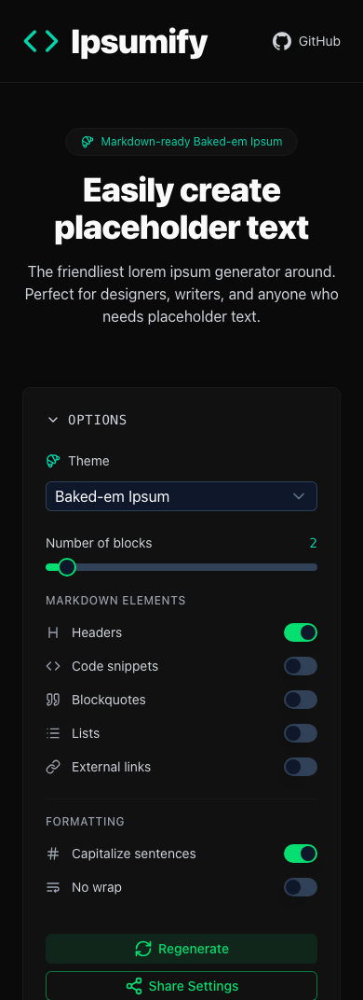

# Ipsumify

[](https://github.com/ICJIA/ipsumify-next-2026/actions/workflows/ci.yml)
[](https://nuxt.com/)
[](https://ui.nuxt.com/)
[](https://tailwindcss.com/)
[](https://www.typescriptlang.org/)
[](https://opensource.org/licenses/MIT)
[](https://app.netlify.com/projects/ipsumify/deploys)

## Easily Create Placeholder Text

> The friendliest lorem ipsum generator around. Perfect for designers, writers, and anyone who needs placeholder text.


With a theme and the markdown elements switched on:



The output panel, with Regenerate and Copy in its top bar:



On the command line, with `npx ipsumify` (the commands' actual output, rendered as an image):



From the API (again the real responses, rendered as an image):



The [technical details](https://ipsumify.com/technical-details) page:



On a phone:



## Site

https://ipsumify.com

## Table of Contents

- [Features](#features)
- [Themes](#themes)
- [Command Line and npm Package](#command-line-and-npm-package)
- [API](#api)
  - [Strict requests](#strict-requests)
  - [Caching and Fair Use](#caching-and-fair-use)
- [Tech Stack](#tech-stack)
- [Getting Started](#getting-started)
- [Project Structure](#project-structure)
- [Configuration](#configuration)
- [Deployment](#deployment)
  - [Netlify](#netlify)
- [Architecture](#architecture)
  - [SEO with ssr: false](#seo-with-ssr-false)
- [Accessibility & Quality Scores](#accessibility--quality-scores)
- [Security Policy](#security-policy)
- [Security and Logic Audits](#security-and-logic-audits)
  - [Red team / blue team exercise (10 November 2026)](#red-team--blue-team-exercise-10-november-2026)
  - [Security and logic audit (10 November 2026)](#security-and-logic-audit-10-november-2026)
  - [Application health check (16 September 2026)](#application-health-check-16-september-2026)
- [Contributing](#contributing)
- [License](#license)
- [Acknowledgments](#acknowledgments)

## Features

- **Markdown-Ready Output** - Generate lorem ipsum with headers, code blocks, blockquotes, lists, and links
- **Multiple Themes** - Choose from classic Lorem Ipsum or fun themed alternatives (dog, cat, baked, BBQ)
- **Customizable Blocks** - Control the number of text blocks (1-20)
- **Formatting Options** - Toggle capitalization and no-wrap mode for cleaner copy-paste
- **One-Click Actions** - Regenerate, copy as Markdown or as rendered HTML, or download as an `.md` file, all from the bar above the output
- **Shareable URLs** - Share your exact settings and seed via URL so others see the same output
- **Remembered Preferences** - Theme, block count, and options are saved in your browser's `localStorage`; click the Ipsumify logo to reset everything to defaults
- **Technical Details Page** - [ipsumify.com/technical-details](https://ipsumify.com/technical-details) explains how it all works, as an infographic with diagrams and a live worked example
- **Command Line and npm Package** - `npx ipsumify` prints lorem ipsum in your terminal; `import ipsumify from 'ipsumify'` does the same in Node
- **Public API** - REST endpoint with multiple output formats (markdown, JSON, text, HTML) — no API key required
- **Deterministic Output** - Seeded RNG produces identical results for the same parameters, enabling CDN caching
- **Keyboard Shortcuts** - Alt+Shift+R / C / D to regenerate, copy, and download (Option+Shift on Mac); press `?` to list them
- **Dark Theme** - Beautiful dark UI optimized for developers and designers
- **Accessible** - Lighthouse accessibility score of 100 and zero axe-core WCAG A/AA violations
- **SEO Optimized** - Built-in sitemap, robots.txt, and meta tags

## Themes

Ipsumify includes the classic Lorem Ipsum as the default, plus several fun themed alternatives. All themes use Latin-style placeholder text to maintain the traditional Lorem Ipsum aesthetic.

| Theme                     | Description                                          |
| ------------------------- | ---------------------------------------------------- |
| **Lorem Ipsum** (default) | Classic Latin placeholder text                       |
| **Dog-em Ipsum**          | Latinized dog breed names and canine terminology     |
| **Cat-em Ipsum**          | Latinized cat breed names and feline terminology     |
| **Baked-em Ipsum**        | French and Latin pastry and baking terms             |
| **BBQ-em Ipsum**          | Latinized barbecue cuts, techniques, and terminology |

Switch themes using the dropdown in the Options panel. All your other settings (blocks, markdown elements, formatting) are preserved when switching themes.

## Command Line and npm Package

The generator is published to npm as [`ipsumify`](https://www.npmjs.com/package/ipsumify).

```bash
npx ipsumify
```

With no arguments it prints five paragraphs of classic lorem ipsum. Nothing to install, no dependencies, Node 18.3 or later.

It uses the same engine as [ipsumify.com](https://ipsumify.com) and its API: the same theme, block count, seed, and options give the same text in all three.

### Options

| Option | Short | What it does |
| ------ | ----- | ------------ |
| `--blocks <n>` | `-b` | Number of paragraphs, 1–20. Default 5. Also accepted as the first argument (`npx ipsumify 3`) or as `--paragraphs` / `-p`; give it one way only |
| `--theme <id>` | `-t` | `lorem` (default), `dog`, `cat`, `baked`, `bbq` |
| `--seed <n>` | `-s` | Whole number from 0 to 2,147,483,647. The same seed always gives the same text. Random when omitted |
| `--headings` | | Add markdown headings (also `--headers`) |
| `--code` | | Add code snippets |
| `--quotes` | | Add blockquotes |
| `--lists` | | Add bullet lists |
| `--links` | | Add links |
| `--all` | `-a` | All five markdown elements |
| `--md <list>` | | The same, comma-separated, as the API takes them: `--md headings,lists` |
| `--lower` | | Lowercase everything |
| `--no-linebreaks` | | Everything on one line (also `--nowrap`) |
| `--format <name>` | `-f` | `markdown` (default), `text`, `html`, `json` |
| `--themes` | | List the themes |
| `--help` | `-h` | Show help |
| `--version` | `-v` | Show the version |

Code snippets appear before every third block, blockquotes before every second, lists before the third, sixth, and so on, and links before every fourth, so a short run may not include every element you asked for.

Invalid input prints a message to stderr and exits with code 1.

### Examples

One paragraph. `--seed` makes it repeatable; leave it off for different text each run:

```console
$ npx ipsumify 1 --seed 42
Neque porro quisquam est, qui dolorem ipsum quia dolor sit amet, consectetur, adipisci velit, sed quia non numquam eius modi tempora incidunt. Duis aute irure dolor in reprehenderit in voluptate velit esse cillum dolore eu fugiat nulla pariatur. Excepteur sint occaecat cupidatat non proident. Lorem ipsum dolor sit amet, consectetur adipiscing elit. Sed do eiusmod tempor incididunt ut labore et dolore magna aliqua. Ut enim ad minim veniam, quis nostrud exercitation ullamco laboris.
```

A theme, with headings and a list:

```console
$ npx ipsumify 3 --theme bbq --headings --lists --seed 7
# Building the Perfect Fire

Brisketum planum puntum totum, pinguem capsum updownum debatum. Fumus annulus roseum halum, probatum technicum igneum. Sectum contra granum semper, humidus macer finibus ustum. Pullum femur quartum totum, pellis crispum carnem sucum. Alabama salsamentum album, acetum Carolina moppum stylum. Tractum fumatum grillum optiones, gallinaceum rectum bonum.

Fumus surgit caminus ascendit, linea formatur mane fidelis. Venditum signum timendum, mane avis obtinet carneum. Dignum omnis expectatio minutum, pitmasterus ars respectum. Fricatum siccum pasta humidum, pernoctem frigidarium marinatum requiem. Sal piper simplex Texanum, complexum Memphis mixtum secretum. Applicare generosum aequum tegmen, cortex formatur pulchre.

- Smoky goodness
- Fall off the bone
- Worth the wait

Lateribus fabae coleslavium paniscornum, caseum macaroni salatum tuberosum. Pickledus cepae jalapeñus, panisalbus butyrum sectum. Completum plateum aequilibratum prandium, carneum stella lateribus sustentum.
```

One line, lowercase — handy for seed data:

```console
$ npx ipsumify 1 --theme cat --no-linebreaks --lower --seed 3
himalayan persicum pointus fluffium, exotic shorthair teddybearum calmicus. ragamuffin largeum sweeticus docilum, selkirk rex curlycoatum sheepii patientum. laperm curlicus wavium uniqueum.
```

Rendered HTML:

```console
$ npx ipsumify 1 --all --format html --seed 42
<h1>Key Concepts</h1>
<pre><code class="language-javascript">const example = &#39;code&#39;;
</code></pre>
<p><a href="https://example.com">Learn more</a> Neque porro quisquam est, qui dolorem ipsum quia dolor sit amet, consectetur, adipisci velit, sed quia non numquam eius modi tempora incidunt. Duis aute irure dolor in reprehenderit in voluptate velit esse cillum dolore eu fugiat nulla pariatur. Excepteur sint occaecat cupidatat non proident. Lorem ipsum dolor sit amet, consectetur adipiscing elit. Sed do eiusmod tempor incididunt ut labore et dolore magna aliqua. Ut enim ad minim veniam, quis nostrud exercitation ullamco laboris.</p>
```

Plain text, with the markdown syntax stripped:

```console
$ npx ipsumify 1 --all --format text --seed 42
Key Concepts

Learn more Neque porro quisquam est, qui dolorem ipsum quia dolor sit amet, consectetur, adipisci velit, sed quia non numquam eius modi tempora incidunt. Duis aute irure dolor in reprehenderit in voluptate velit esse cillum dolore eu fugiat nulla pariatur. Excepteur sint occaecat cupidatat non proident. Lorem ipsum dolor sit amet, consectetur adipiscing elit. Sed do eiusmod tempor incididunt ut labore et dolore magna aliqua. Ut enim ad minim veniam, quis nostrud exercitation ullamco laboris.
```

JSON, in the same shape the API returns. `output` holds each paragraph's body text; `seed` reports the seed that was used, so a random run can be reproduced:

```console
$ npx ipsumify 2 --format json --seed 42
{
  "theme": "lorem",
  "blocks": 2,
  "seed": 42,
  "format": "json",
  "options": {
    "headers": false,
    "codeSnippets": false,
    "blockquotes": false,
    "lists": false,
    "links": false,
    "capitalize": true,
    "noWrap": false
  },
  "output": [
    "Neque porro quisquam est, qui dolorem ipsum quia dolor sit amet, consectetur, adipisci velit, sed quia non numquam eius modi tempora incidunt. Duis aute irure dolor in reprehenderit in voluptate velit esse cillum dolore eu fugiat nulla pariatur. Excepteur sint occaecat cupidatat non proident. Lorem ipsum dolor sit amet, consectetur adipiscing elit. Sed do eiusmod tempor incididunt ut labore et dolore magna aliqua. Ut enim ad minim veniam, quis nostrud exercitation ullamco laboris.",
    "Sed ut perspiciatis unde omnis iste natus error sit voluptatem accusantium doloremque laudantium, totam rem aperiam, eaque ipsa quae ab illo inventore veritatis. Nam libero tempore, cum soluta nobis est eligendi optio cumque nihil impedit quo minus id quod maxime placeat facere possimus, omnis voluptas assumenda est. Nemo enim ipsam voluptatem quia voluptas sit aspernatur aut odit aut fugit, sed quia consequuntur magni dolores eos qui ratione voluptatem sequi nesciunt."
  ],
  "markdown": "Neque porro quisquam est, qui dolorem ipsum quia dolor sit amet, consectetur, adipisci velit, sed quia non numquam eius modi tempora incidunt. Duis aute irure dolor in reprehenderit in voluptate velit esse cillum dolore eu fugiat nulla pariatur. Excepteur sint occaecat cupidatat non proident. Lorem ipsum dolor sit amet, consectetur adipiscing elit. Sed do eiusmod tempor incididunt ut labore et dolore magna aliqua. Ut enim ad minim veniam, quis nostrud exercitation ullamco laboris.\n\nSed ut perspiciatis unde omnis iste natus error sit voluptatem accusantium doloremque laudantium, totam rem aperiam, eaque ipsa quae ab illo inventore veritatis. Nam libero tempore, cum soluta nobis est eligendi optio cumque nihil impedit quo minus id quod maxime placeat facere possimus, omnis voluptas assumenda est. Nemo enim ipsam voluptatem quia voluptas sit aspernatur aut odit aut fugit, sed quia consequuntur magni dolores eos qui ratione voluptatem sequi nesciunt."
}
```

Into a file or the clipboard:

```bash
npx ipsumify 10 --all > placeholder.md
npx ipsumify | pbcopy
```

### Use from JavaScript

```bash
npm install ipsumify
```

```js
import ipsumify, { paragraphs, themes } from 'ipsumify'

ipsumify()                                          // five paragraphs, random
ipsumify({ blocks: 2, theme: 'dog', seed: 42 })     // repeatable
ipsumify({ headers: true, lists: true })            // markdown elements
ipsumify({ format: 'html' })                        // or 'text'

paragraphs({ blocks: 3 })                           // ['…', '…', '…']
themes                                              // [{ id: 'lorem', label: 'Lorem Ipsum' }, …]
```

| Option | Type | Default | |
| ------ | ---- | ------- | - |
| `theme` | string | `'lorem'` | `lorem`, `dog`, `cat`, `baked`, `bbq` |
| `blocks` | number | `5` | 1–20 |
| `seed` | number | random | 0–2,147,483,647 |
| `headers`, `code`, `quotes`, `lists`, `links` | boolean | `false` | Markdown elements |
| `lowercase` | boolean | `false` | Lowercase everything |
| `noWrap` | boolean | `false` | Everything on one line |
| `format` | string | `'markdown'` | `markdown`, `text`, `html` |

An unknown theme or format, or a `blocks` or `seed` out of range, throws a `RangeError`. Options that are not an object, or a switch that is not `true` or `false`, throw a `TypeError`. `paragraphs()` ignores `format`. The package is ESM only and ships its own TypeScript types.

### Building and publishing the package

The package's source is in `packages/ipsumify/`. `yarn build:cli` bundles it, with the generator and themes from this repository, into `packages/ipsumify/dist/`. It has no dependencies and shares the app's version number.

Publishing is done with `publish.sh`, from a terminal, after a release (version bumped in `package.json`, `ipsumify.config.ts`, and `packages/ipsumify/package.json`; `CHANGELOG.md` section added; `main` and the `vX.Y.Z` tag pushed; CI green):

```bash
./publish.sh --dry-run   # every check and a dry-run publish; changes nothing
./publish.sh             # the same checks, then publishes after you type the version and approve in npm
```

The script builds and tests the tag's own commit in a temporary worktree, checks the package's contents, installs the packed tarball in a scratch project and runs it, and publishes that same tarball. It never commits, tags, or pushes. A release that changes only the website does not need publishing.

## API

Ipsumify includes a public REST API deployed as a Netlify Function. Call it with no parameters for sensible defaults, or customize the output with query parameters.

### Quick Start

```bash
# Default: 5 blocks of classic lorem ipsum as markdown
curl https://ipsumify.com/api/generate
```

### Examples

**Get 10 blocks of classic lorem ipsum:**

```bash
curl "https://ipsumify.com/api/generate?blocks=10"
```

**Get JSON array of individual blocks (useful for populating UI components):**

```bash
curl "https://ipsumify.com/api/generate?format=json&blocks=4"
```

**Get plain text with no markdown syntax:**

```bash
curl "https://ipsumify.com/api/generate?format=text&blocks=2"
```

**Get rendered HTML:**

```bash
curl "https://ipsumify.com/api/generate?format=html&blocks=3"
```

**Include markdown elements (headers, code blocks, lists):**

```bash
curl "https://ipsumify.com/api/generate?md=headers,code,lists&blocks=5"
```

**Lowercase, single-line output (good for seed data):**

```bash
curl "https://ipsumify.com/api/generate?lower=1&nowrap=1&blocks=2"
```

**Deterministic output with a specific seed:**

```bash
curl "https://ipsumify.com/api/generate?seed=123&blocks=3"
```

**Get 3 blocks of dog-themed text:**

```bash
curl "https://ipsumify.com/api/generate?theme=dog&blocks=3"
```

### Parameters

| Parameter | Type   | Default    | Description                                                          |
| --------- | ------ | ---------- | -------------------------------------------------------------------- |
| `theme`   | string | `lorem`    | Theme ID: `lorem`, `dog`, `cat`, `baked`, `bbq`                     |
| `blocks`  | number | `5`        | Number of text blocks (1-20)                                        |
| `seed`    | number | `42`       | RNG seed for deterministic output: a whole number from 0 to 2,147,483,647 |
| `format`  | string | `markdown` | Response format: `markdown`, `json`, `text`, `html`                 |
| `md`      | string | _(none)_   | Comma-separated markdown elements: `headers,code,quotes,lists,links`. `headings` also works for `headers` |
| `lower`   | string | _(off)_    | Set to `1` to disable capitalization                                |
| `nowrap`  | string | _(off)_    | Set to `1` for single-line output                                   |

### Response Format

Every response is JSON, whatever the `Accept` header. A success has this structure:

```json
{
  "theme": "lorem",
  "blocks": 5,
  "seed": 42,
  "format": "markdown",
  "output": "..."
}
```

The `json` format additionally includes `options` and returns `output` as an array of strings (one per block of body text, without markdown elements) plus a `markdown` field with the full text.

### Strict requests

The API accepts a request only if it is written one way, and answers anything else with HTTP 400 and a `message` saying what was wrong:

```json
{
  "error": true,
  "statusCode": 400,
  "message": "Invalid theme \"zzz\". Valid themes: lorem, dog, cat, baked, bbq"
}
```

- **Only the seven parameters above.** An unknown parameter is an error, not ignored.
- **Each parameter once.** Use `md=headers,code`, not `md=headers&md=code`.
- **Plain values.** Letters, digits, and commas, with no percent-encoding or `+`, and no empty values (`theme=`).
- **Numbers written plainly.** `blocks=5`, not `05`, `5.0`, or `5e0`.
- **`md` names from the list**, each once.
- **`lower=1` and `nowrap=1`**, or leave them out.

This strictness is what keeps the CDN cache correct: the cache and the API must agree exactly on what a URL means. See the [audit](#security-and-logic-audits).

### Known Limitations

- **Seeds repeat every 233,280 values:** `seed=42` and `seed=233322` return the same text, and some different seeds give the same text for a short output.
- **A blockquote repeats the block it precedes:** it quotes the first 100 characters of the block that follows it.
- **`format=text` drops code snippets** rather than keeping their contents.
- **No rate limit.** See [Caching and Fair Use](#caching-and-fair-use).

### Caching and Fair Use

The API is public with no authentication required. Successful responses are cached at the CDN edge (`Cache-Control: public, max-age=3600`) since identical parameters always produce identical output. Repeated requests with the same parameters are served from cache without invoking the serverless function. Errors are never cached (`Cache-Control: no-store`).

The cache is keyed on the seven documented parameters (`Netlify-Vary`). There is no rate limit; each uncached request does a small, bounded amount of work (at most 20 blocks).

The API is intended for use with `curl` and server-side code. Cross-origin browser requests (e.g., `fetch` from another domain) are blocked — no CORS headers are sent.

### Share URL vs API

Ipsumify has two URL formats that serve different purposes:

| | Share URL | API |
|---|---|---|
| **URL** | `https://ipsumify.com/?theme=dog&blocks=3` | `https://ipsumify.com/api/generate?theme=dog&blocks=3` |
| **Returns** | HTML page (the web app with settings pre-filled) | JSON with generated text |
| **Use case** | Share a link so someone sees the same text in their browser | Programmatically retrieve generated text |
| **curl/fetch** | Returns the full HTML page — not useful for text extraction | Returns structured JSON — designed for this |

The share URL and API take the same parameters with the same meanings (`theme`, `blocks`, `md`, `lower`, `nowrap`, `seed`). The API additionally accepts `format`. Share Settings always writes the current `seed` into the link, so a link made after Regenerate reproduces the regenerated text. They differ in how they treat bad input: a share link ignores a parameter it cannot use and falls back to the default, where the API returns a 400.

A share link shows exactly what it describes: anything it leaves out is at its default, regardless of the preferences the person opening it has saved. Opening one shows its settings without touching your saved preferences. If you then change a setting, what is on screen becomes your saved preferences. Clicking the logo resets everything and removes the link's parameters from the address bar.

## Tech Stack

| Technology                                    | Version | Description                                |
| --------------------------------------------- | ------- | ------------------------------------------ |
| [Nuxt](https://nuxt.com/)                     | 4.x     | Vue.js meta-framework                      |
| [Nuxt UI](https://ui.nuxt.com/)               | 4.x     | Beautiful UI component library             |
| [Tailwind CSS](https://tailwindcss.com/)      | 4.x     | Utility-first CSS framework                |
| [TypeScript](https://www.typescriptlang.org/) | 5.x     | Type-safe JavaScript                       |
| [@nuxtjs/seo](https://nuxtseo.com/)           | 3.x     | SEO module with sitemap and robots.txt     |
| [@nuxt/eslint](https://eslint.nuxt.com/)      | 1.x     | ESLint integration with Nuxt flat config   |
| [marked](https://marked.js.org/)              | 17.x    | Markdown-to-HTML for Copy as HTML and the API's `html` format |
| [Vitest](https://vitest.dev/)                 | 4.x     | Unit tests (with happy-dom)                |
| [Lucide Icons](https://lucide.dev/)           | -       | Beautiful open-source icons                |

## Getting Started

### Prerequisites

- Node.js 22.23.4 (see `.nvmrc`; Netlify and CI use the same version). Nuxt 4.6 supports `^22.22.3`, `^24.15.0`, and 26 or later, and nothing in between
- Yarn 1.22.x (or npm/pnpm)

### Installation

```bash
# Clone the repository
git clone https://github.com/ICJIA/ipsumify-next-2026.git
cd ipsumify-next-2026

# Install dependencies
yarn install

# Start development server
yarn dev
```

The app will be available at `http://localhost:3000`.

### Development Workflow

Before committing, run lint and typecheck:

```bash
yarn lint
yarn typecheck
```

Use `yarn lint:fix` to auto-fix ESLint issues where possible.

To run a production build locally, page and API together, build it for Node and start it:

```bash
NITRO_PRESET=node-server npx nuxt build
node .output/server/index.mjs
```

### Available Scripts

| Command            | Description                                     |
| ------------------ | ----------------------------------------------- |
| `yarn dev`         | Start development server with hot reload        |
| `yarn build`       | Build for production (hybrid: static pages + serverless API), then write the pages' CSP into `dist/_headers` |
| `yarn build:cli`   | Build the npm package into `packages/ipsumify/dist/`         |
| `yarn build:diagrams` | Re-render the Mermaid diagrams after editing a file in `diagrams/`. Uses an installed Chrome (set `CHROME_PATH` if it is not in the default macOS location) |
| `yarn generate`    | Generate a fully static site in `.output/public` (no API, and no Content-Security-Policy: `write-csp.mjs` runs only after `yarn build`) |
| `yarn preview`     | Not supported for the Netlify build this project makes; it prints a message and exits. To run a production build locally, see below |
| `yarn test`        | Run lint, typecheck, and unit tests                          |
| `yarn test:all`    | Run lint, typecheck, unit tests, a production build, and the npm package build |
| `yarn test:unit`   | Run Vitest unit tests                                        |
| `yarn test:unit:watch` | Run Vitest in watch mode                                 |
| `yarn test:coverage` | Run unit tests with a coverage report (what CI runs)       |
| `yarn test:ui`     | Open the Vitest UI                                           |
| `yarn lint`        | Run ESLint on the codebase                                   |
| `yarn lint:fix`    | Run ESLint with auto-fix                                     |
| `yarn typecheck`   | Run TypeScript type checking                                 |
| `yarn postinstall` | Prepare Nuxt (runs automatically after install)              |

## Project Structure

```
ipsumify/
├── app/                    # Nuxt 4 app directory
│   ├── app.vue             # Root component
│   ├── assets/
│   │   └── css/
│   │       └── main.css    # Global styles and Tailwind imports
│   └── pages/
│       ├── index.vue             # The generator
│       └── technical-details.vue # How it works: infographic with diagrams
├── data/
│   └── themes.ts           # Theme content (paragraphs, headings, list items)
├── diagrams/               # Mermaid sources for the technical details page
├── composables/
│   ├── useKeyboardShortcuts.ts # Keyboard shortcut handler
│   ├── useLocalStorage.ts      # Type-safe localStorage wrapper
│   ├── usePreferences.ts       # User preference persistence
│   └── useShareUrl.ts          # Shareable URL generation
├── packages/
│   └── ipsumify/               # The npm package: command line and library
├── scripts/
│   ├── build-diagrams.mjs      # Renders diagrams/*.mmd to public/diagrams/*.svg
│   └── write-csp.mjs           # Post-build: hashes inline scripts into the CSP
├── server/
│   ├── api/
│   │   └── generate.get.ts     # GET /api/generate endpoint
│   └── middleware/
│       └── guard.ts            # Security headers, and a real 404 for unknown URLs
├── utils/
│   ├── clipboard.ts        # Clipboard utility with fallback
│   ├── apiQuery.ts         # Strict parsing of the API's query string
│   ├── generate.ts         # Shared text generation (web UI, API, npm package)
│   ├── html.ts             # HTML rendering of generated text
│   └── random.ts           # Seeded PRNG utilities
├── tests/
│   └── unit/               # Vitest unit tests (apiQuery, cli, generate, html, keyboard, random, useLocalStorage, usePreferences, useShareUrl)
├── documentation/          # Screenshots for README
├── public/
│   ├── diagrams/           # The diagrams, rendered to SVG (yarn build:diagrams)
│   ├── icon.svg            # Favicon
│   ├── llms.txt            # Site and API summary for LLMs (llmstxt.org)
│   └── og-image.png        # Open Graph image for social sharing
├── .github/                # CI workflow, Dependabot config, issue and PR templates
├── app.config.ts           # Nuxt UI colors (primary, neutral)
├── eslint.config.mjs      # ESLint flat config (auto-generated by @nuxt/eslint)
├── ipsumify.config.ts     # Single source of truth for all app config
├── netlify.toml           # Netlify build and security headers
├── nuxt.config.ts         # Nuxt configuration
├── package.json            # Dependencies and scripts
├── publish.sh              # Checks a release and publishes the npm package
├── tsconfig.json           # TypeScript configuration
└── vitest.config.ts        # Vitest configuration
```

## Configuration

**ipsumify.config.ts** is the single source of truth for app configuration. The `nuxt.config.ts` imports from it for SEO, meta tags, and head. Edit `ipsumify.config.ts` for:

| Key                                            | Description                                  |
| ---------------------------------------------- | -------------------------------------------- |
| `name`, `title`, `description`, `shortDescription` | Site identity and SEO                    |
| `url`, `github`, `changelog`, `author`         | URLs and attribution; `github` and `changelog` are linked from the footer |
| `technicalDetailsPath`, `technicalDetailsUrl`, `technicalDetailsTitle`, `technicalDetailsDescription` | The technical details page's address and head tags |
| `datePublished`, `dateModified`                | ISO dates for the JSON-LD structured data; update `dateModified` by hand on release |
| `locale`, `defaultLocale`                      | Open Graph locale and HTML `lang`            |
| `ogImageUrl`, `ogImageWidth`, `ogImageHeight`, `ogImageAlt`, `faviconPath` | Social image and favicon |
| `primaryColor`, `backgroundColor`, `tileColor` | Theme colors (hex)                           |
| `defaultThemeId`                               | Default theme (lorem, dog, cat, baked, bbq)  |
| `defaultBlocks`                                | Default number of text blocks (1-20)         |
| `defaultSeed`                                  | Seed used on first load, after a reset, and by the API when none is given |
| `version`                                      | App version (keep in sync with package.json) |

### Theme Colors (Nuxt UI)

Edit `app.config.ts` to customize Nuxt UI component colors:

```typescript
export default defineAppConfig({
  ui: {
    colors: {
      primary: "teal", // Primary accent color
      neutral: "zinc", // Neutral/gray color
    },
  },
});
```

### Adding New Themes

Add a new theme in `data/themes.ts`:

1. Add an object to the `themes` array with `id`, `label`, `icon`, `paragraphs`, `headings`, and `listItems`
2. Use a Lucide icon class (e.g. `i-lucide-scroll-text`) for the `icon` field. Icons are compiled into the bundle at build time and never fetched; theme icons are picked up from `data/themes.ts` automatically. An icon from another collection needs its `@iconify-json/*` package installed
3. Optionally set `defaultThemeId` in `ipsumify.config.ts` to make it the default

## Deployment

### Netlify

The project deploys as a hybrid site on Netlify: pages are prerendered as static files, and the API runs as a Netlify Function.

- **Build command:** `yarn build`
- **Publish directory:** `dist`
- **Node version:** 22.23.4 (set in `netlify.toml`)
- **Security headers:** `X-Frame-Options`, `X-Content-Type-Options`, `Referrer-Policy`, `Permissions-Policy`, and HSTS come from `netlify.toml`. The Content-Security-Policy is generated at build time by `scripts/write-csp.mjs`, which hashes the inline scripts of every prerendered page and writes the policy to `dist/_headers`. Netlify applies all of these to the static pages and their assets. Everything else is answered by the function, which sets its own: `server/middleware/guard.ts` for every response, and `server/api/generate.get.ts` for the API
- **Unknown URLs** get a plain-text 404 from the function, not the app's HTML shell
- **API:** `server/api/` routes are automatically deployed as Netlify Functions

1. Connect your repository to Netlify
2. Netlify will automatically detect the build settings from `netlify.toml`
3. Deploy!

## Architecture

- **Hybrid deployment:** The two pages (`/` and `/technical-details`) are prerendered as static files. A serverless function (Netlify Functions via Nitro) runs the API, serves `robots.txt` and `sitemap.xml`, and answers every other URL with a 404
- **Shared generation logic:** Both the web UI and API use `utils/generate.ts` — same code, same output
- **Deterministic output:** Uses a seeded LCPRNG so identical parameters always produce identical text (enables aggressive CDN caching)
- **Config hierarchy:** `ipsumify.config.ts` → `nuxt.config.ts`; theme content lives in `data/themes.ts`
- **Client-side generation:** The web UI generates text in the browser and never calls the API
- **No third-party requests:** Icons are compiled into the client bundle; the page loads nothing from any other origin, and its CSP allows none

### SEO with `ssr: false`

SSR is disabled because reka-ui (used by Nuxt UI v4) crashed during server-side rendering when the app was built. This means `useSeoMeta()` in page components only runs client-side — without further work, crawlers and SEO audit tools would see a raw HTML shell without Open Graph, Twitter Card, or canonical tags.

**Solution:** All SEO meta tags are defined explicitly in `app.head` inside `nuxt.config.ts` rather than relying on `useSeoMeta()`. Tags defined in `app.head` are baked into the prerendered HTML at build time, so they're visible to crawlers without JavaScript execution.

Every prerendered page starts as the same shell, so the technical details page's static HTML is given its own title, description, and canonical by a `prerender:generate` hook in `nuxt.config.ts`.

If you modify SEO tags, update them in **both** places:
- `nuxt.config.ts` → `app.head.meta` (for crawlers)
- `app/pages/index.vue` → `useSeoMeta()` (for client-side SPA navigation)

`app/app.vue` adds two client-side corrections for `@nuxtjs/seo` under `ssr: false`: an absolute `rel=canonical` (the module would otherwise emit a relative one), and a plain `%s` title template (the module's default leaves a literal `%siteName` in the tab title).

**Note:** The `@nuxtjs/seo` module's `nuxt-seo-utils` auto-detects files like `og-image.png` in the `public/` directory and injects `og:image` tags with relative paths. To prevent this, ensure `app.head` already includes an `og:image` tag with an absolute URL — the module skips auto-injection when it detects an existing tag.

## Accessibility & Quality Scores

Measured on 10 November 2026 against the live site, https://ipsumify.com, running v2.6.0.

### Lighthouse (desktop)

| Category       | Score |
| -------------- | ----- |
| Performance    | 100   |
| Accessibility  | 100   |
| Best Practices | 100   |
| SEO            | 100   |

### axe-core

| Viewport | WCAG A + AA violations |
| -------- | ---------------------- |
| Desktop  | 0                      |
| Mobile   | 0                      |

## Security Policy

**Reporting a vulnerability.** Please do not open a public issue. Open a private advisory at [github.com/ICJIA/ipsumify-next-2026/security/advisories](https://github.com/ICJIA/ipsumify-next-2026/security/advisories). [SECURITY.md](SECURITY.md) has the full policy, including what to include and when to expect a reply.

**What is in place.**

- No accounts, no cookies, and no user data kept on a server. Settings stay in the browser's `localStorage` and are validated when read back.
- No requests to any other site: scripts, styles, fonts, and icons are all served from `ipsumify.com`.
- A Content-Security-Policy that allows the pages' inline scripts only by SHA-256 hash, computed on every build.
- An API that parses its query string strictly, caches only well-formed requests, and sets its own security headers.
- A plain 404 for unknown URLs, and security headers on everything the server function returns.
- An npm package with no dependencies and no install scripts, published only after the release script has installed and run the exact file it publishes.
- CI with a read-only token and actions pinned to commit hashes.

**How it has been tested.** Each audit, with every finding and its fix, is in the next section.

## Security and Logic Audits

Newest first. The most recent is given in full; earlier ones are summarised, with every finding kept.

| Date | Audit | Released in | Findings |
| ---- | ----- | ----------- | -------- |
| 10 November 2026 | [Red team / blue team exercise](#red-team--blue-team-exercise-10-november-2026) | v2.6.0 | 18: 1 medium, 14 low, 3 informational. All fixed |
| 10 November 2026 | [Security and logic audit](#security-and-logic-audit-10-november-2026) | v2.4.0, v2.5.0 | 18: 2 medium, 16 low or informational. 16 fixed, 1 mitigated, 1 accepted; two of the fixes were completed in v2.6.0 |
| 16 September 2026 | [Application health check](#application-health-check-16-september-2026) | v2.3.0 – v2.3.2 | 5 defects, all fixed |

No audit has found a high or critical issue in the app's own code: it has no accounts, stores no user data on the server, and renders no untrusted HTML.

### Red team / blue team exercise (10 November 2026)

**Method.** After the audit below was fixed and released as v2.5.0, an independent reviewer (a separate AI agent, given the code and a list of what had been fixed, but not how) was given the repository and told to attack it: the API, the Content-Security-Policy and its build script, the client logic, the npm package, the release process, and every factual claim in the documentation. It was told what the earlier audit had fixed and asked to look for bypasses. It could run the code locally and send a limited number of ordinary GET requests to the live site (about 59 were sent). The blue team then verified each finding, fixed it, added tests, and re-tested locally and in production. Unit tests went from 95 to 128.

**The headline: the earlier cache fix could be bypassed, and worse.** v2.5.0 told the CDN to key its cache on the API's seven parameter names. The CDN compares those names against the raw URL; the API's query parser percent-decoded them first. So `?th%65me=dog` was `theme=dog` to the API and an unknown, ignored name to the cache, and the dog-themed text was stored for the URL with no theme at all. Anyone could make a clean API URL, including the bare `/api/generate`, return a different (valid) response for up to an hour. It was reproduced on the live site. No data was at risk, but the API's promise that a URL always returns the same text was not being kept.

The fix replaces the query parser for the API with one that decodes nothing: a request is accepted only if every name is literally one of the seven, appears once, and has a plain value written in exactly one way. Everything else is an HTTP 400, and errors are no longer cached at all. The cache and the API can no longer disagree about what a URL means, because the API refuses any URL where they might.

#### Findings

| # | Finding | Severity | Status | Fix |
| - | ------- | -------- | ------ | --- |
| R1 | **CDN cache poisoning through percent-encoded parameter names** (`th%65me=dog`), reproduced in production | Medium | Fixed | `utils/apiQuery.ts` parses the raw query string and refuses unknown, encoded, or repeated names with a 400; 400s are sent `Cache-Control: no-store` |
| R2 | **The junk-parameter cache fix was bypassable with junk values**: `md=anything`, `lower=zz`, `blocks=05`, and `seed=0000000042` all returned the normal text under a new cache key | Low | Fixed | Unknown or repeated `md` names, switch values other than `1`, leading zeros, and empty values are all 400s. One output now has a small, fixed number of URLs |
| R3 | **A repeated parameter could be read differently by the cache and the API.** `lower=1&lower=1` was silently ignored; `md=a&md=b` was joined | Low | Fixed | Any parameter given twice is a 400. This reverses the previous audit's choice to join repeated `md` values |
| R4 | **API errors depended on the `Accept` header.** A browser got an HTML page for a 400, with a policy that blocked that page's own scripts | Low | Fixed | Errors are returned by the handler as JSON, always, with the handler's own headers. The body is now `{ error, statusCode, message }` |
| R5 | **Everything the function served, apart from the API, had no CSP and no clickjacking protection**: `robots.txt`, `sitemap.xml`, and the app shell that Nuxt returned for any unknown URL | Low | Fixed | `server/middleware/guard.ts` sets the security headers on every function response |
| R6 | **Unknown URLs were soft 404s.** `/anything` returned HTTP 200 with the app shell, marked indexable, with a broken page title, and ran the function every time | Low | Fixed | Unknown paths get a plain-text 404 with `X-Robots-Tag: noindex`, cached for five minutes. `/favicon.ico`, which used to return 78 bytes of text labelled as an image, is one of them |
| R7 | **A share link with all-default options did not reproduce the sender's text** for a recipient with saved preferences: the link omits defaults, and the gaps were filled from the recipient's own settings | Low | Fixed | When the URL is a share link, whatever it omits is the default. Verified in a browser with deliberately different saved preferences |
| R8 | **`md=headings` worked on the command line but was silently ignored by the API and share links** | Low | Fixed | `headings` is accepted everywhere as another name for `headers` |
| R9 | **Share links read `blocks=7abc` as 7** (`parseInt`), where the API rejects it | Low | Fixed | Digits only |
| R10 | **Keyboard shortcuts:** holding Alt+Shift+D saved the file repeatedly; the chords also fired with Ctrl or Cmd held; a `keydown` event with no key (browser autofill sends these) threw an error | Low | Fixed | Repeats and keyless events are ignored, modifiers must match exactly, and typing in a field is left alone |
| R11 | **`nowrap` with `headers` and `format=html` returned the whole text inside one `<h1>`** (API, command line, and Copy as HTML) | Low | Fixed | HTML is rendered from the wrapped text, then put on one line |
| R12 | **The command line accepted `--md __proto__`, `--md constructor`**, and other inherited property names as markdown elements. No harm resulted | Low | Fixed | Looked up in a `Map` |
| R13 | **The command line silently dropped a conflicting block count** (`ipsumify 3 --blocks 1` printed one block) | Low | Fixed | Giving the count more than once is an error |
| R14 | **Library small print:** `paragraphs()` rejected a `format` it documents as ignored; `ipsumify('dog')` silently returned default text and `ipsumify(null)` threw a raw error; `headers: 'false'` (a string) switched headings on; the exported `themes` and `FORMATS` could be modified by callers; `require('ipsumify')` failed | Low | Fixed | Options must be an object and switches must be booleans (`TypeError` otherwise); the exports are frozen; a `default` export condition was added |
| R15 | **CI ran with a write-capable token**, actions pinned by movable tags, the checkout's credentials left on disk for every dependency's install script, and a secret exposed to every step | Low | Fixed | `permissions: contents: read`, actions pinned to commit hashes, `persist-credentials: false`, the secret scoped to its one step. CI now installs the Node version in `.nvmrc`, which is the gap that let v2.4.0's failed deploy through |
| R16 | **`scripts/write-csp.mjs` wrote a second policy if run twice on the same build** | Info | Fixed | It replaces any policy it wrote before |
| R17 | **`publish.sh` read the changelog from the working tree, not the release's tag, and did not check the tag was on GitHub.** `package.json` `engines` also admitted Node versions Nuxt does not support | Info | Fixed | The changelog is read from the tag; the tag must exist on origin at the same commit; `engines` matches Nuxt's range |
| R18 | **Documentation that was not true**: 16 statements across the README, SECURITY.md, the changelog, and code comments, most of them describing the two incomplete fixes above | Info | Fixed | Each corrected. Among them: `yarn preview` does not work with this build, and "all responses return JSON" was false until R4 |

#### What the red team tried that held

- **Header injection and response splitting** through the reflected error message: control characters are stripped and long values refused.
- **Cross-site scripting**: there is no `v-html` or `innerHTML`; rendered HTML only ever goes to the clipboard and is built only from the themes' fixed text; URL and saved values are checked against allow-lists.
- **Type confusion and prototype keys** in the API (`theme[]=`, `__proto__=`, `constructor=`, full-width digits, oversized lists): all answered with a clean 200 or 400, never a 500.
- **Regular-expression denial of service**: every pattern is linear, and none runs on caller-supplied text.
- **The page's Content-Security-Policy**: all five hashes on the live site matched the scripts actually served.
- **The npm package**: the published `ipsumify@2.5.0` was byte-for-byte what a local build of the tagged source produces, with no dependencies and no install scripts. Its output was identical under Node 18.3 and 22.
- **`publish.sh`**: no path was found that publishes an unreviewed or untested build.
- **The README's 12 console examples** matched the real output exactly.

#### Left as it is, and why

- **No rate limit.** Each uncached request is small and bounded, and the number of distinct valid URLs is now finite per output. A real limit needs Netlify's paid rate-limiting rules.
- **`style-src 'unsafe-inline'`** in the page's policy: the UI library sets element styles at runtime.
- **Seeds repeat every 233,280 values.** Changing the generator would change the text behind every existing link.

#### Recommended, but a repository setting rather than code

- Protect the `main` branch on GitHub, and set the repository's default workflow token to read-only. The workflow now asks for read-only itself, but `main` is both the production deploy and what `publish.sh` trusts, and it currently accepts direct pushes.

### Security and logic audit (10 November 2026)

The whole codebase was read and the running app and API probed with edge-case input. Released in v2.4.0 and v2.5.0; unit tests went from 58 to 95. Two of its fixes (S2 and S4) were later shown to be incomplete by the red team above.

| # | Finding | Severity | Outcome |
| - | ------- | -------- | ------- |
| S1 | 351 known advisories in dependencies (8 critical, 179 high); 26 Dependabot pull requests unmerged since February | Medium | Fixed: everything updated; 12 advisories remain, none critical or high, all in build tooling or a disabled module |
| S2 | Repeating a query parameter (`?md=a&md=b`) crashed the API with a 500 | Low | Fixed by joining the values; replaced in v2.6.0 by refusing repeats (R3) |
| S3 | The API had almost no security headers | Low | Fixed: the handler sets its own |
| S4 | The CDN cache was bypassed by any extra parameter; no rate limit | Low | Mitigated with a `Netlify-Vary` cache key and a bounded seed; found bypassable and completed in v2.6.0 (R1, R2) |
| S5 | Icons were fetched from `api.iconify.design` on every first visit | Low | Fixed: compiled into the bundle; the page makes no third-party requests |
| S6 | The page's CSP allowed any inline script | Low | Fixed: inline scripts allowed by per-build SHA-256 hash |
| S7 | Deprecated `X-XSS-Protection` header | Info | Fixed: removed |
| S8 | Saved preferences were trusted as read; a bad value could freeze the page on every visit | Low | Fixed: every field validated |
| S9 | `style-src` allows inline styles | Info | Accepted |
| L1 | `format=json` with `md=headers` returned an `output` array that did not match its `markdown` field (491 of 500 seeds) | Low | Fixed: one generation pass produces both |
| L2 | Negative seeds produced broken text | Low | Fixed: seeds normalized and range-checked. Text for valid seeds unchanged (167,310 comparisons) |
| L3 | The API accepted `seed=`, `seed=1e3`, and `blocks=1.0` | Low | Fixed: whole numbers only |
| L4 | `format=text` with `nowrap=1` left markdown markers in the text | Low | Fixed |
| L5 | Opening a share link replaced the visitor's saved preferences | Low | Fixed: nothing is saved until the visitor changes a setting |
| L6 | The copy shortcut reported success even when the copy failed | Low | Fixed |
| L7 | Regenerate could leave the text unchanged | Low | Fixed: redraws until it changes |
| L8 | On phones the wordmark overlapped the GitHub link | Low | Fixed |
| L9 | v2.4.0 could not deploy: the updated Nuxt needed a newer Node than `.nvmrc` pinned | Medium | Fixed: one Node version in `.nvmrc`, `netlify.toml`, and (since v2.6.0) CI |

### Application health check (16 September 2026)

A check of the build, CI, and the app in a browser. Released in v2.3.0 to v2.3.2.

| # | Finding | Outcome |
| - | ------- | ------- |
| H1 | CI had failed on every push for a day: `vue-tsc` was undeclared, so the typecheck fetched an incompatible latest version | Fixed: declared and locked |
| H2 | The browser tab read "… \| %siteName": the SEO module's title template never resolved with server rendering off | Fixed: a plain title template |
| H3 | A share link made after Regenerate showed the recipient different words, because links did not carry the seed | Fixed: the seed is in the link, range-checked on the way in |
| H4 | CI built with a command Netlify never runs and uploaded a directory that did not exist, reporting success; a failing coverage upload was hidden | Fixed: CI runs the real build, checks its output, and fails loudly |
| H5 | An unused Docker deployment path, and a README that named the wrong Netlify publish directory | Removed and corrected |

## Contributing

Contributions are welcome! Please feel free to submit a Pull Request. See [CONTRIBUTING.md](CONTRIBUTING.md) for the full guide.

1. Fork the repository
2. Create your feature branch (`git checkout -b feature/amazing-feature`)
3. Commit your changes (`git commit -m 'Add some amazing feature'`)
4. Push to the branch (`git push origin feature/amazing-feature`)
5. Open a Pull Request

## License

This project is licensed under the MIT License - see the [LICENSE](LICENSE) file for details.

## Acknowledgments

- [Nuxt](https://nuxt.com/) - The intuitive Vue framework
- [Nuxt UI](https://ui.nuxt.com/) - Beautiful UI components
- [Tailwind CSS](https://tailwindcss.com/) - Utility-first CSS
- [Lucide](https://lucide.dev/) - Beautiful open-source icons
