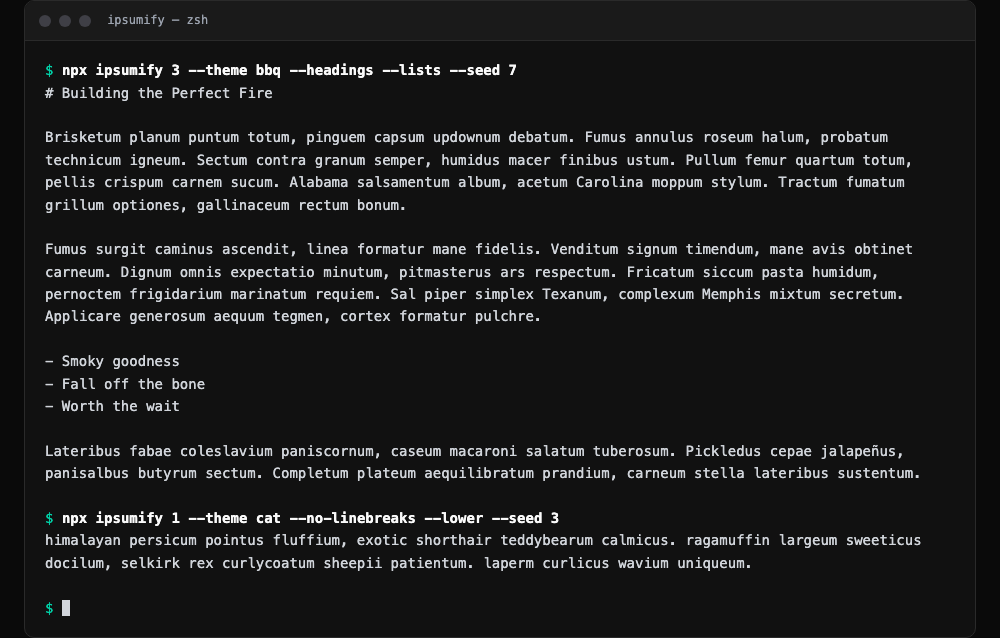

# ipsumify

Lorem ipsum for the command line and Node: markdown-ready placeholder text with themes, seeds, and plain text, HTML, or JSON output.

```bash
npx ipsumify
```



With no arguments it prints five paragraphs of classic lorem ipsum. Nothing to install, no dependencies, Node 18.3 or later.

It uses the same engine as [ipsumify.com](https://ipsumify.com) and its API: the same theme, block count, seed, and options give the same text in all three.

### Options

| Option | Short | What it does |
| ------ | ----- | ------------ |
| `--blocks <n>` | `-b` | Number of paragraphs, 1–20. Default 5. Also accepted as the first argument (`npx ipsumify 3`) or as `--paragraphs` / `-p`; give it one way only |
| `--theme <id>` | `-t` | `lorem` (default), `dog`, `cat`, `baked`, `bbq` |
| `--seed <n>` | `-s` | Whole number from 0 to 2,147,483,647. The same seed always gives the same text. Random when omitted |
| `--headings` | | Add markdown headings (also `--headers`) |
| `--code` | | Add code snippets |
| `--quotes` | | Add blockquotes |
| `--lists` | | Add bullet lists |
| `--links` | | Add links |
| `--all` | `-a` | All five markdown elements |
| `--md <list>` | | The same, comma-separated, as the API takes them: `--md headings,lists` |
| `--lower` | | Lowercase everything |
| `--no-linebreaks` | | Everything on one line (also `--nowrap`) |
| `--format <name>` | `-f` | `markdown` (default), `text`, `html`, `json` |
| `--themes` | | List the themes |
| `--help` | `-h` | Show help |
| `--version` | `-v` | Show the version |

Code snippets appear before every third block, blockquotes before every second, lists before the third, sixth, and so on, and links before every fourth, so a short run may not include every element you asked for.

Invalid input prints a message to stderr and exits with code 1.

### Examples

One paragraph. `--seed` makes it repeatable; leave it off for different text each run:

```console
$ npx ipsumify 1 --seed 42
Neque porro quisquam est, qui dolorem ipsum quia dolor sit amet, consectetur, adipisci velit, sed quia non numquam eius modi tempora incidunt. Duis aute irure dolor in reprehenderit in voluptate velit esse cillum dolore eu fugiat nulla pariatur. Excepteur sint occaecat cupidatat non proident. Lorem ipsum dolor sit amet, consectetur adipiscing elit. Sed do eiusmod tempor incididunt ut labore et dolore magna aliqua. Ut enim ad minim veniam, quis nostrud exercitation ullamco laboris.
```

A theme, with headings and a list:

```console
$ npx ipsumify 3 --theme bbq --headings --lists --seed 7
# Building the Perfect Fire

Brisketum planum puntum totum, pinguem capsum updownum debatum. Fumus annulus roseum halum, probatum technicum igneum. Sectum contra granum semper, humidus macer finibus ustum. Pullum femur quartum totum, pellis crispum carnem sucum. Alabama salsamentum album, acetum Carolina moppum stylum. Tractum fumatum grillum optiones, gallinaceum rectum bonum.

Fumus surgit caminus ascendit, linea formatur mane fidelis. Venditum signum timendum, mane avis obtinet carneum. Dignum omnis expectatio minutum, pitmasterus ars respectum. Fricatum siccum pasta humidum, pernoctem frigidarium marinatum requiem. Sal piper simplex Texanum, complexum Memphis mixtum secretum. Applicare generosum aequum tegmen, cortex formatur pulchre.

- Smoky goodness
- Fall off the bone
- Worth the wait

Lateribus fabae coleslavium paniscornum, caseum macaroni salatum tuberosum. Pickledus cepae jalapeñus, panisalbus butyrum sectum. Completum plateum aequilibratum prandium, carneum stella lateribus sustentum.
```

One line, lowercase — handy for seed data:

```console
$ npx ipsumify 1 --theme cat --no-linebreaks --lower --seed 3
himalayan persicum pointus fluffium, exotic shorthair teddybearum calmicus. ragamuffin largeum sweeticus docilum, selkirk rex curlycoatum sheepii patientum. laperm curlicus wavium uniqueum.
```

Rendered HTML:

```console
$ npx ipsumify 1 --all --format html --seed 42
<h1>Key Concepts</h1>
<pre><code class="language-javascript">const example = &#39;code&#39;;
</code></pre>
<p><a href="https://example.com">Learn more</a> Neque porro quisquam est, qui dolorem ipsum quia dolor sit amet, consectetur, adipisci velit, sed quia non numquam eius modi tempora incidunt. Duis aute irure dolor in reprehenderit in voluptate velit esse cillum dolore eu fugiat nulla pariatur. Excepteur sint occaecat cupidatat non proident. Lorem ipsum dolor sit amet, consectetur adipiscing elit. Sed do eiusmod tempor incididunt ut labore et dolore magna aliqua. Ut enim ad minim veniam, quis nostrud exercitation ullamco laboris.</p>
```

Plain text, with the markdown syntax stripped:

```console
$ npx ipsumify 1 --all --format text --seed 42
Key Concepts

Learn more Neque porro quisquam est, qui dolorem ipsum quia dolor sit amet, consectetur, adipisci velit, sed quia non numquam eius modi tempora incidunt. Duis aute irure dolor in reprehenderit in voluptate velit esse cillum dolore eu fugiat nulla pariatur. Excepteur sint occaecat cupidatat non proident. Lorem ipsum dolor sit amet, consectetur adipiscing elit. Sed do eiusmod tempor incididunt ut labore et dolore magna aliqua. Ut enim ad minim veniam, quis nostrud exercitation ullamco laboris.
```

JSON, in the same shape the API returns. `output` holds each paragraph's body text; `seed` reports the seed that was used, so a random run can be reproduced:

```console
$ npx ipsumify 2 --format json --seed 42
{
  "theme": "lorem",
  "blocks": 2,
  "seed": 42,
  "format": "json",
  "options": {
    "headers": false,
    "codeSnippets": false,
    "blockquotes": false,
    "lists": false,
    "links": false,
    "capitalize": true,
    "noWrap": false
  },
  "output": [
    "Neque porro quisquam est, qui dolorem ipsum quia dolor sit amet, consectetur, adipisci velit, sed quia non numquam eius modi tempora incidunt. Duis aute irure dolor in reprehenderit in voluptate velit esse cillum dolore eu fugiat nulla pariatur. Excepteur sint occaecat cupidatat non proident. Lorem ipsum dolor sit amet, consectetur adipiscing elit. Sed do eiusmod tempor incididunt ut labore et dolore magna aliqua. Ut enim ad minim veniam, quis nostrud exercitation ullamco laboris.",
    "Sed ut perspiciatis unde omnis iste natus error sit voluptatem accusantium doloremque laudantium, totam rem aperiam, eaque ipsa quae ab illo inventore veritatis. Nam libero tempore, cum soluta nobis est eligendi optio cumque nihil impedit quo minus id quod maxime placeat facere possimus, omnis voluptas assumenda est. Nemo enim ipsam voluptatem quia voluptas sit aspernatur aut odit aut fugit, sed quia consequuntur magni dolores eos qui ratione voluptatem sequi nesciunt."
  ],
  "markdown": "Neque porro quisquam est, qui dolorem ipsum quia dolor sit amet, consectetur, adipisci velit, sed quia non numquam eius modi tempora incidunt. Duis aute irure dolor in reprehenderit in voluptate velit esse cillum dolore eu fugiat nulla pariatur. Excepteur sint occaecat cupidatat non proident. Lorem ipsum dolor sit amet, consectetur adipiscing elit. Sed do eiusmod tempor incididunt ut labore et dolore magna aliqua. Ut enim ad minim veniam, quis nostrud exercitation ullamco laboris.\n\nSed ut perspiciatis unde omnis iste natus error sit voluptatem accusantium doloremque laudantium, totam rem aperiam, eaque ipsa quae ab illo inventore veritatis. Nam libero tempore, cum soluta nobis est eligendi optio cumque nihil impedit quo minus id quod maxime placeat facere possimus, omnis voluptas assumenda est. Nemo enim ipsam voluptatem quia voluptas sit aspernatur aut odit aut fugit, sed quia consequuntur magni dolores eos qui ratione voluptatem sequi nesciunt."
}
```

Into a file or the clipboard:

```bash
npx ipsumify 10 --all > placeholder.md
npx ipsumify | pbcopy
```

### Use from JavaScript

```bash
npm install ipsumify
```

```js
import ipsumify, { paragraphs, themes } from 'ipsumify'

ipsumify()                                          // five paragraphs, random
ipsumify({ blocks: 2, theme: 'dog', seed: 42 })     // repeatable
ipsumify({ headers: true, lists: true })            // markdown elements
ipsumify({ format: 'html' })                        // or 'text'

paragraphs({ blocks: 3 })                           // ['…', '…', '…']
themes                                              // [{ id: 'lorem', label: 'Lorem Ipsum' }, …]
```

| Option | Type | Default | |
| ------ | ---- | ------- | - |
| `theme` | string | `'lorem'` | `lorem`, `dog`, `cat`, `baked`, `bbq` |
| `blocks` | number | `5` | 1–20 |
| `seed` | number | random | 0–2,147,483,647 |
| `headers`, `code`, `quotes`, `lists`, `links` | boolean | `false` | Markdown elements |
| `lowercase` | boolean | `false` | Lowercase everything |
| `noWrap` | boolean | `false` | Everything on one line |
| `format` | string | `'markdown'` | `markdown`, `text`, `html` |

An unknown theme or format, or a `blocks` or `seed` out of range, throws a `RangeError`. Options that are not an object, or a switch that is not `true` or `false`, throw a `TypeError`. `paragraphs()` ignores `format`. The package is ESM only and ships its own TypeScript types.

## Links

- Web app: https://ipsumify.com
- Source and issues: https://github.com/ICJIA/ipsumify-next-2026

## License

MIT
